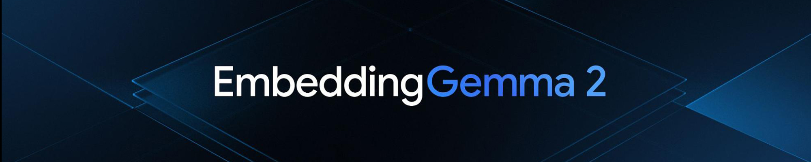

# EmbeddingGemma 2 — Complete Guide

[](https://colab.research.google.com/github/fabriciocarraro/EmbeddingGemma-2-Complete-Guide/blob/main/EmbeddingGemma_2_Complete_Guide.ipynb)

**EmbeddingGemma 2** is Google DeepMind's open multimodal embedding model. It maps text (including code), images, audio, and video into the same 768-dimensional vector space, has 740M parameters, runs on a laptop, and is released under the Apache 2.0 license.

It follows the structure of our [Gemini Embedding 2 — Complete Guide](https://github.com/fabriciocarraro/Gemini-Embedding-2-Complete-Guide) and uses the same media files (included here), but stands on its own: you don't need the Gemini guide or its repository to follow it. The question behind it: *can a small open model running on your own machine do what Gemini Embedding 2 does through an API?*

---

## What is this?

A hands-on notebook that walks you through everything EmbeddingGemma 2 can do, from "king − man + woman = queen" to cross-modal searches where an image finds a sound or a voice clip finds a video, **and** an honest account of where it differs from Gemini Embedding 2. It is not a drop-in replacement: the dimensions, the way you pass audio and video, the task prompts, and PDF support all change.

Everything runs in a single Google Colab (GPU runtime) or locally. No API key needed: the model weights (~1.5 GB) are downloaded from Hugging Face on the first run.

---

## Authors

- **Fabrício Carraro** - [LinkedIn](https://www.linkedin.com/in/fabriciocarraro/) - fabriciocarraro@gmail.com
- **Pedro Gengo** - [LinkedIn](https://www.linkedin.com/in/pedrogengo/) - pedro.gengo.lourenco@gmail.com

---

## Gemini Embedding 2 vs EmbeddingGemma 2

| | Gemini Embedding 2 | EmbeddingGemma 2 |
|---|---|---|
| How you run it | Gemini API, API key, cloud | Open weights, local, no key |
| License | Proprietary API | Apache 2.0 |
| Size | Not disclosed | 740M parameters (270M text-only) |
| Embedding size | 3,072 (MRL to 128) | 768 (MRL: 512, 256, 128) |
| Text / Images | ✅ / ✅ | ✅ (+ code, with task prompts) / ✅ |
| Audio | ✅ native files | ✅ as 16 kHz mono waveform |
| Video | ✅ (frames only) | ✅ (frames only, 1 fps, ≤32 frames by default) |
| PDF | ✅ native (≤6 pages) | ❌ not supported → pages rendered as images |

Details for every change are in [MIGRATION_NOTES.md](MIGRATION_NOTES.md), and what was (and wasn't) tested is in [TEST_REPORT.md](TEST_REPORT.md).

---

## What's Inside

**📝 Text Embeddings** — What embeddings are, task prompts, cosine similarity, and the classic "king − man + woman = queen" experiment. Plus text clustering with TensorBoard's Projector and a static t-SNE map.

**🖼️ Image Embeddings** — Image-to-text matching, image-to-image comparison, image embedding arithmetic (king − crown = man).

**🔍 Image Search** — A full similarity search engine built with FAISS and Tiny ImageNet. Upload your own image (or use a held-out one) and find the closest matches.

**🧩 Combined Multimodal Embeddings** — Text + images in a single embedding for social media posts, then searching across 5 posts that all mention "Gemini" in different contexts (AI model, zodiac sign, NASA mission).

**🔊 Audio Embeddings** — Text-to-audio search, audio-to-audio matching, and image-to-audio cross-modal search (and why that last one is the hardest: hubness).

**🎬 Video Embeddings** — Text-to-video, audio-to-video, and video-to-video similarity search, with a look at the exact frames the model sees and a higher per-frame token budget.

**📄 PDF Documents** — Not a native input anymore: PDFs are rendered page by page and embedded as images (with plain-text extraction as a comparison), then used for text-to-PDF, audio-to-PDF, and PDF-to-PDF search.

**📐 Dimensionality** — Matryoshka Representation Learning: from 768 down to 128 dimensions.

**🪶 Selective loading** — Loading only the text encoder (270M parameters) when you don't need images or audio.

**🏁 Recap** — Every experiment's expected answer vs. what the model returned, with the margin of each result.

---

## Results at a glance

From the executed notebook in this repository (`bfloat16`, RTX 3050 Laptop GPU, 4 GB). "Margin" is the gap between the first and second places (below ~0.01 is practically a tie). The last column is the top result in the Gemini Embedding 2 guide, for reference, when the inputs are identical.

| Experiment | Expected | EmbeddingGemma 2 | Found? | Margin | Gemini guide |
|---|---|---|---|---|---|
| Most similar pair (man/woman/dog/electricity) | man ↔ woman | man ↔ woman | ✅ | 0.023 | man ↔ woman |
| king − man + woman | queen | queen | ✅ | 0.095 | queen* |
| Washington, D.C. − USA + Brazil | Brasilia | Brasilia | ✅ | 0.045 | Brasilia |
| King image → closest word | king | king | ✅ | 0.066 | king |
| King image → closest image | crown | crown | ✅ | 0.132 | crown |
| King image − crown image → closest image | man | man | ✅ | 0.108 | man |
| Tweet about the Gemini AI model → closest post | Post 1 or 2 | Post 2 (image carousel) | ✅ | 0.017 | Post 1 |
| "Emergency vehicle siren" text → audio | ambulance | ambulance | ✅ | 0.028 | — (different query) |
| Scary-forest voice clip → audio | wolf | wolf | ✅ | 0.052 | wolf |
| Ambulance image → audio | ambulance | rain | ❌ | 0.040 | ambulance |
| "Animals for my documentary" text → video | Dog | Dog | ✅ | 0.074 | Dog |
| Animal voice clip → video | Dog | Dog | ✅ | 0.057 | Dog |
| Surf video → video | Waves | Waves | ✅ | 0.073 | Waves |
| "Animals and identifying them" text → PDF | Ducks | Ducks (page images) | ✅ | 0.079 | Ducks |
| Animal voice clip → PDF | Ducks | Ducks (page images) | ✅ | 0.046 | Ducks |
| Solar System PDF → PDF | NASA Exoplanets | NASA Exoplanets | ✅ | 0.031 | NASA Exoplanets |

\* Top non-source word: the Gemini guide's table showed "king" itself first because the source words weren't actually excluded (fixed here).

**15 of 16 found.** The miss is photo → sound effect: the rain clip is the closest sound to 5 of the 6 images (hubness), and neither a higher image token budget nor an image + question query fixed it. The posts row depends on the prompt: with the symmetric `SentenceSimilarity` prompt, Post 1 wins. Also: the FAISS search with a held-out goldfish image returned the 5 goldfish in the index, and AG News items have a same-category nearest neighbor 85% of the time.

Take it for what it is: 16 hand-picked examples, not a benchmark. For benchmarks, see the [model card](https://huggingface.co/google/embeddinggemma-2).

---

## Getting Started

### Google Colab

1. Open the notebook with the badge above.
2. Choose a GPU runtime (*Runtime → Change runtime type → T4 GPU*).
3. Run the cells. The first code cell installs what Colab doesn't have.

### Locally

```bash
python -m venv .venv
.venv/Scripts/activate        # Windows (on Linux/macOS: source .venv/bin/activate)
pip install torch torchvision --index-url https://download.pytorch.org/whl/cu130   # or the CPU build
pip install -r requirements.txt
jupyter lab EmbeddingGemma_2_Complete_Guide.ipynb
```

To run it top to bottom without interactive widgets (TensorBoard server, file picker, view counter), set `NOTEBOOK_HEADLESS=1`, e.g.:

```bash
NOTEBOOK_HEADLESS=1 jupyter nbconvert --to notebook --execute EmbeddingGemma_2_Complete_Guide.ipynb --output executed.ipynb
```

The images, audios, videos, and PDFs are in this repository (`images/`, `audios/`, `videos/`, `PDFs/`). Run from a clone, the notebook reads them from disk; in Colab it downloads them from this repository on GitHub (`BASE_URL` in the notebook). If you fork or rename the repository, update `BASE_URL` and the Colab badge link above.

---

## Dependencies

| Library | Purpose |
|---|---|
| `sentence-transformers` (≥ 6.1) / `transformers` (≥ 5.22) | Loading and running EmbeddingGemma 2 |
| `torch` | Inference (GPU recommended, `bfloat16`; never `float16`) |
| `faiss-cpu` | Fast similarity search (FAISS) |
| `librosa` / `soundfile` | Decoding audio and resampling to 16 kHz mono |
| `av` (PyAV) | Decoding video frames |
| `pymupdf` | Rendering PDF pages as images / extracting text |
| `scikit-learn` | Cosine similarity, t-SNE |
| `tensorboard` | Embedding visualization (Projector) |
| `datasets` | Hugging Face dataset loading |
| `matplotlib` / `Pillow` | Image display and plotting |
| `pandas` / `numpy` | Data manipulation |
